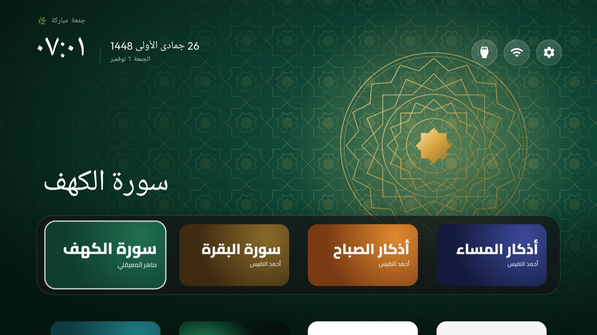
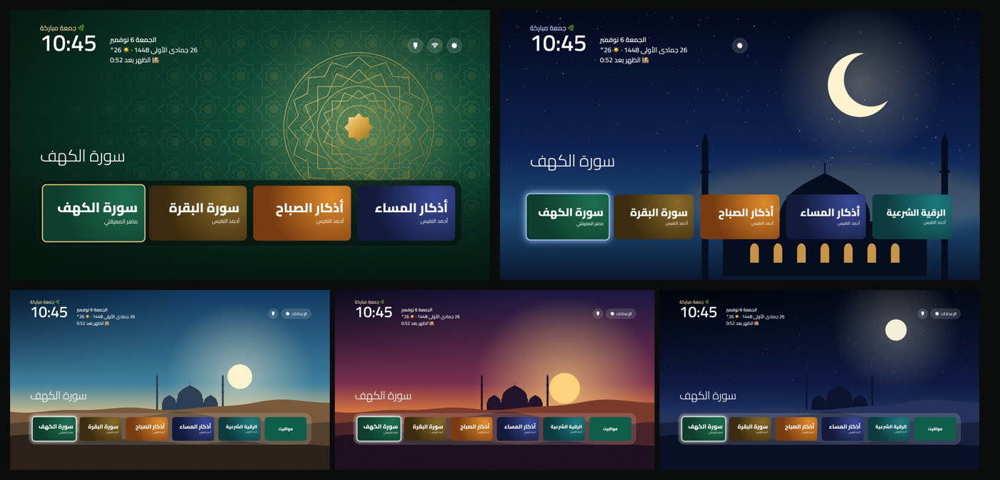

<div dir="rtl">

# 📺 نور تي في

**نظّف تلفزيونك من الإعلانات، وخلّه يأذّن ويذكّرك بالصلاة.**
كلود يسوي كل شي، ويمشّيك خطوة خطوة بكلام بسيط.



## شنو بتحصل؟

- 🧹 **بلا إعلانات:** يعطّل تطبيقات الشركة اللي تجمع بياناتك وتعرض إعلانات (**تعطيل مو حذف**، وترجع بأمر واحد)
- 🕌 **الأذان:** وقت الصلاة يأذّن. ولو تشوف فيلم، يطلع لك تنبيه بس وما يقطع عليك
- 🗓️ **فوق الساعة:** التاريخ الهجري، والطقس، والصلاة الجاية بعد كم
- 📖 **كروت بضغطة وحدة:** سورة الكهف، سورة البقرة، أذكار الصباح، أذكار المساء، الرقية الشرعية
- 🌿 **يوم الجمعة:** يذكّرك بسورة الكهف، وبالأيام البيض يبيّنها لك
- ﷺ **كل شوي:** سطر صغير «صلّ على النبي ﷺ»
- 💌 **من جوالك:** اكتب «أحبك» أو ارسم قلب، ويطلع على التلفزيون لايف
- 🎨 **3 أشكال تختار منها:** الزخرفة، مسجد الليل، أوقات اليوم



## يشتغل على شنو؟

✅ أندرويد تي في وقوقل تي في بس (تي سي إل، سوني، شاومي، هايسنس أندرويد، فيليبس أندرويد...)
❌ سامسونق وإل جي ما يشتغلون عليهم (أنظمتهم مو أندرويد)

## تحتاج

1. لابتوب (ماك أو ويندوز) فيه [كلود كود](https://claude.com/claude-code)
2. التلفزيون واللابتوب على **نفس الواي فاي**

## الطريقة: 3 خطوات بس

**1. افتح كلود كود والصق هالسطر:**

```
نظّف تلفزيوني بـ github.com/majedphotos/noor-tv واقرا skills/noor-tv/SKILL.md وامشِ عليه خطوة خطوة
```

**2. سوّ اللي يقول لك.** خطوة وحدة بكل مرة. الشي الوحيد اللي تسويه بإيدك: تضغط 7 مرات بإعدادات التلفزيون عشان تفعّل «خيارات المطوّر»، وكلود يقول لك وين بالضبط.

**3. خلاص.** كلود يدوّر على تلفزيونك بروحه، يعطيك تقرير بكل شي عطّله، ويعطيك رابط صفحة الرسايل من جوالك.

<details>
<summary>تبيه كبلقن بكلود كود؟</summary>

```
/plugin marketplace add majedphotos/noor-tv
/plugin install noor-tv@noor-tv
```

بعدها قول لكلود: «نظّف تلفزيوني».
</details>

## ⚠️ اقرا قبل ما تبدي

- **عطّل لا تحذف.** فيه ناس خرّبوا تلفزيوناتهم لما حذفوا تطبيقات النظام. هالسكل ما يحذف شي أبداً، يعطّل بس.
- قبل أي تغيير، تنحفظ نسخة احتياطية بجهازك، ومعاها أمر يرجّع كل شي مثل ما كان.
- كلود يستأذنك قبل كل دفعة تعطيل.
- الاستخدام على مسؤوليتك.

## شكر

مبني على [CleanYourTV](https://github.com/Gathin23/cleanyourtv) (رخصة MIT) ✨.
مواقيت الصلاة والتاريخ الهجري من [Aladhan](https://aladhan.com)، والطقس من [Open-Meteo](https://open-meteo.com).

</div>
